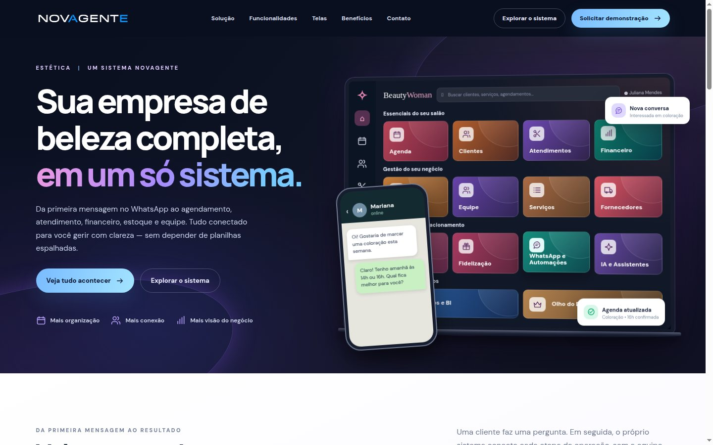
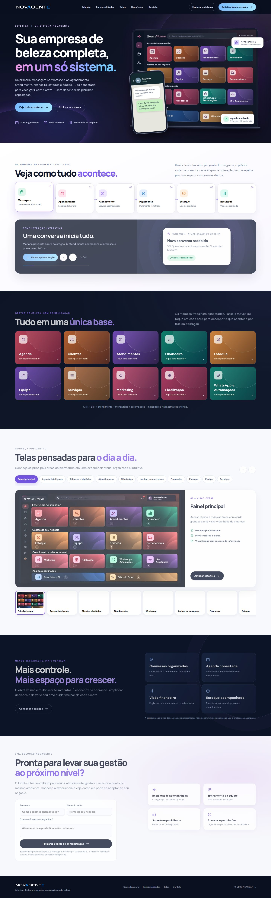

# ESTÉTICA
### Gestão completa para negócios de beleza

**Uma solução NOVAGENTE**

Landing page interativa de apresentação, com agenda, clientes, WhatsApp, atendimento, financeiro, estoque, equipe e automações em uma experiência integrada.

**Versão:** V11 &nbsp;·&nbsp; **Repositório:** público &nbsp;·&nbsp; **Hospedagem no domínio:** em configuração

---

## Prévia da página

  

<strong>Ver captura da página completa (rolagem)</strong>

  

<strong>Ver versão para celular</strong>

  

## Resumo

| Campo | Descrição |
| :--- | :--- |
| **Produto** | ESTÉTICA |
| **Marca desenvolvedora** | NOVAGENTE |
| **Objetivo** | Apresentar visualmente a plataforma de gestão para negócios de beleza |
| **Destaques** | Agenda, CRM, WhatsApp, clientes, financeiro, estoque, equipe, serviços e automações |
| **Interface** | Responsiva, com navegação, módulos de demonstração e animações |
| **Tecnologias** | HTML, CSS e JavaScript (sem etapa de compilação) |
| **Arquivo de entrada** | [index.html](./index.html) |
| **Domínio previsto** | `estetica.novagente.com.br` — ainda não publicado |
| **Estado** | Landing disponível em código; integração real com o sistema não incluída |

## Como visualizar a landing

1. Abra **[index.html](./index.html)** no GitHub.
2. Clique em **Download raw file** (ou baixe a pasta/repositório).
3. Abra o arquivo `index.html` no navegador. As imagens e estilos já estão incorporados.

> **Importante:** esta é a landing page comercial e sua experiência demonstrativa. Ela não é o painel de produção. As conversas, eventos de agenda e demais fluxos exibidos são simulados; não há conexão ativa com WhatsApp, banco de dados, autenticação ou cobrança.

## Publicação futura

A landing pode ser publicada em Cloudflare Pages ou outro provedor estático. O subdomínio planejado é `estetica.novagente.com.br`, dependendo da conclusão do DNS/HTTPS.

---

<strong>NOVAGENTE</strong> · Tecnologia que conecta atendimento, operação e gestão.

